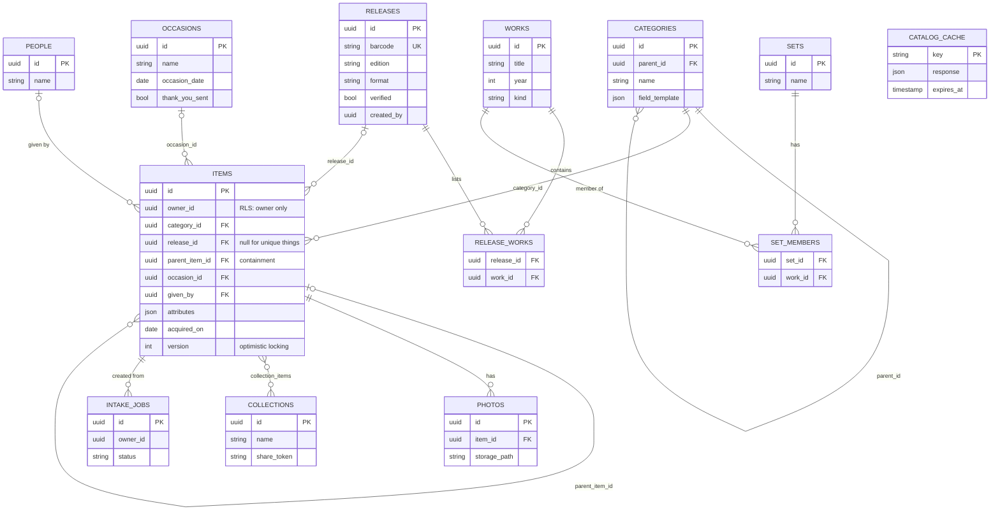
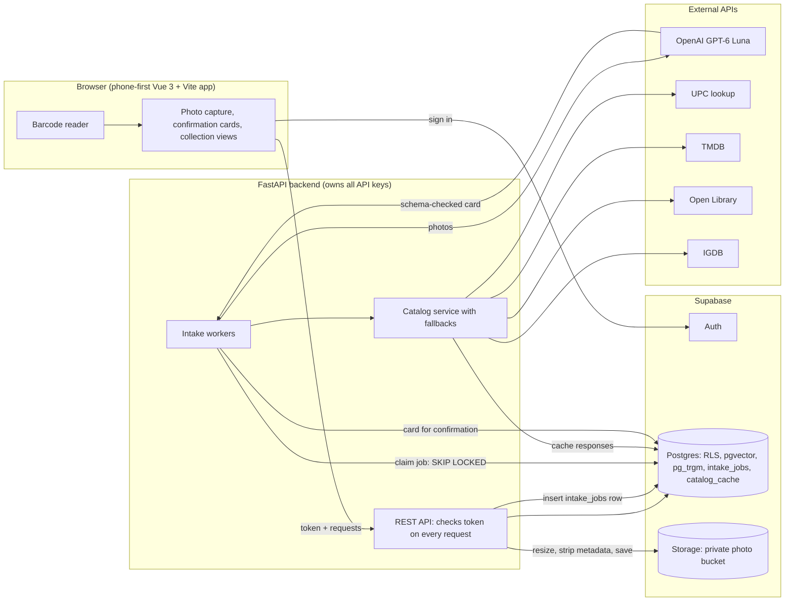

# Provenance — Initial Design & Build Plan

Nov 16, 2026

## Summary

Provenance is a web app for cataloging the specific things you own, down to the exact edition and release, with AI photo intake doing most of the typing. You photograph an item, and the app proposes a card (what it is, which edition, format, condition, details worth keeping) for you to confirm or fix.

- **The problem:** I can't remember which books of a series, which games or which physical movies I already own, and "I own A New Hope" isn't enough. I want to know it's the 4K steelbook, opened and like new, bought on Prime Day 2021.
- **What makes it different:** it tracks **releases, not titles**, and works for anything: a GameCube controller, a LEGO set, a framed print, a wedding-gift air fryer. Unique items (a painting, a family photo) are first-class.
- **Who it's for:** collectors ("what am I missing from this series?") and anyone who wants a home inventory with photos and receipts for insurance.
- **Business angle:** users build a shared database of releases the way Discogs did for music. The first person to scan a barcode creates the release; everyone after gets it instantly. Later revenue: affiliate links on the wishlist, and a premium insurance-inventory export.

## Requirements check

The project meets all three core requirements: it reads and writes data (Postgres, photo storage, catalog APIs), uses AI in the product and to build it, and is scoped for 30 to 40 hours. Canvas deadlines are 06:59 UTC, which is 11:59 pm Mountain the night before.

| Deliverable | Due (11:59 pm MT) | What it needs | Where it comes from |
| --- | --- | --- | --- |
| Final Project Log | Nov 17, 2026 | Markdown log in GitHub (date, what, hours), pushed every session | Starts with the two feasibility tests |
| Presentation signup | Nov 17, 2026 | Pick a slot |  |
| Project Initial Design | Nov 19, 2026 | Markdown in a public GitHub repo: summary (words and pictures), initial ERD, rough system diagram, daily goals to end of class, optional UX sketches | This doc, exported to Markdown |
| Final Project Pitch | Nov 19, 2026 | In class and in the class channel | Summary + feasibility numbers |
| System Design Interview | Nov 19, 2026 | Technology choices, security boundaries, scaling, costs; self-rating 1 to 3 after | System design + Security, scaling and costs sections |
| Collaboration and Reviews | Dec 10, 2026 | 3 hours of collaboration with classmates | Build plan, week 3 |
| Final report | Week of Dec 7 (confirm on Canvas) | Summary, diagrams, demo, 3+ learnings, AI integration, failover, scaling, performance, auth, concurrency, class channel post, share yes or no | Build plan, final days |

## Feasibility evidence

AI photo intake works: on 26 photos of things I own, GPT-6 Luna named the right item every time, and 85% of its cards needed at most one edit, at $0.27 per 1,000 photos. I wrote the answer key; a Sol model judged each card against it.

| Setup | Right item (exact or close) | Exact edition | As is or 1 edit | Cost per 1,000 photos | Median time |
| --- | --- | --- | --- | --- | --- |
| **Luna, 768 px** | **100%** | 42% | **85%** | **$0.27** | 4.3 s |
| Luna, 2048 px | 100% | 46% | 73% | $0.52 | 4.4 s |
| Sol, 768 px | 96% | 38% | 81% | $4.89 | 3.2 s |
| Sol, 2048 px | 92% | 42% | 73% | $9.53 | 3.0 s |

With 26 photos, each percentage is roughly plus or minus 15 points; the differences between setups are within that. What the test changed in the design:

- **Model:** Luna, not Sol. Sol was 18 times the cost and twice confidently wrong (a popcorn tin as a "wastebasket").
- **Releases, not titles:** recognizing the item is solved; the exact edition (steelbook, Deluxe XL, 4K) was right only 42 to 46% of the time. That gap is why the data model separates works from releases, and why intake reads barcodes.
- **The follow-up question is a feature:** for about 8 of the 12 one-edit cards, the model's single question asked for exactly the missing detail ("Blu-ray or DVD?"). The confirmation card shows it as a one-tap question.
- **New releases need catalogs:** items newer than the model's training (the Ocarina of Time Switch 2 remake) are found by barcode or catalog lookup, not by a bigger model.
- **The model proposes, code decides:** catalog searches failed when the model wrote the search text ("Princess Mononoke (1997)"). The model returns a clean title, year and kind; code searches with fallbacks.
- **My answers became columns:** nearly every item had a condition grade, a source (eBay, a wedding gift from a named person) and an approximate date, so those are real fields, not notes.

An earlier test of a different idea (Spoiler Shield) is in the same repo; it is not part of this project.

## Data model (ERD)

The model separates three levels: a **work** (A New Hope), a **release** of it (the 4K steelbook with barcode 0786936…) and my **item** (my copy, opened, bought in 2021). Items are private; works and releases are shared by everyone.

An item points to at most one release, and a release lists the works it contains, so a box set like the Lord of the Rings trilogy is one release with three works. Unique things (the scarecrow, a family photo) have no release and live on their category's fields alone.

- **Categories** are a tree (`parent_id`) whose `field_template` lists the fields for that kind of thing; children inherit them. Brands and platforms are attributes, not categories, so "all my controllers" and "all my Nintendo things" are both one query.
- **Containment** (`parent_item_id`), **category** and **collections** are three different relationships: what it's physically with, what it is, and how I group it. Collections are many-to-many, like playlists.
- **Sets** are the world's checklists (every mainline Zelda game, every piece of a 230-piece tool kit); they power "what am I missing?".
- Two ways to browse the same items: *what it is* (the category tree) and *how I got it* (**occasions**: Christmas 2025, Birthday 2022, Yard sale 11/13/24, Black Friday '23, our wedding). An occasion holds its date once and every item from it inherits it; items with no occasion keep their own `acquired_on`. The two combine: "kitchen things from the wedding".
- **People** record who gave what across every occasion ("everything Momma Hilton has given us"), and `thank_you_sent` turns a wedding or shower occasion into a thank-you tracker.

Key queries:

- **Barcode scan:** `select * from releases where barcode = $1` on a unique index, so a known release costs no AI call.
- **What am I missing:** set members whose work has no item of mine (through `release_works`), one anti-join.
- **Everything under Video Games:** a recursive CTE over `categories`, then items in those categories.
- **Thank-yous left:** items in an occasion that have a giver and `thank_you_sent = false`, grouped by person.

## System design

A phone-first Vue app talks to one FastAPI backend, which owns every API key, the AI intake workers and the catalog lookups; Supabase provides Postgres, photo storage and sign-in. It is the same stack as my Continuity project, so setup is days, not weeks.

The browser signs in with Supabase Auth and sends its token to the API, which checks it on every request; the browser never calls OpenAI or a catalog directly.

| Layer | Choice | Why |
| --- | --- | --- |
| Frontend | Vue 3 + Vite, installable web app | Same as Continuity; the phone camera works through a file input, no app store needed |
| Backend | FastAPI (Python) | Reuses Continuity's patterns; Python has the image tools (Pillow, HEIC support) |
| Database | Supabase Postgres | RLS for the private/shared line, pgvector for duplicate releases, pg_trgm for search, a SKIP LOCKED job queue |
| Files and sign-in | Supabase Storage + Auth | Private bucket with signed URLs; one provider for both |
| AI | OpenAI GPT-6 Luna, low effort | Best accuracy per dollar in the feasibility test |
| Catalogs | UPC lookup (releases), TMDB (films and shows), Open Library (books by ISBN), IGDB (games) | The barcode or ISBN identifies the release; the others name the work |

**Intake, step by step**

1. I photograph the item (front, and the barcode or back if it has one). The browser tries to read the barcode on the spot.
2. The API keeps the photo's date taken (to suggest an occasion), strips GPS and other metadata, saves a 1,024 px copy and a thumbnail, and records an `intake_jobs` row.
3. **Known barcode:** the release is found by index and the card appears instantly, with no AI call.
4. **Otherwise:** a worker claims the job, sends the photos to Luna, and gets back a schema-checked card: category, name, edition, format, attributes, a clean title, year and kind, and one follow-up question.
5. The catalog service searches with that clean title (with fallbacks), links the work, and checks pgvector for a near-identical existing release.
6. I answer the follow-up question, fix anything, and confirm. That saves my item and, if no release existed, a new unverified shared release.

## Security, scaling and costs

The main security boundary is between **private data** (my items, photos, prices, where things are) and **shared data** (works and releases everyone can read). Postgres row-level security enforces it, not the app code.

| Data | Who can read | Who can write | How it's enforced |
| --- | --- | --- | --- |
| Items, photos, collections, occasions, people, notes, price paid, location | Owner only | Owner only | RLS `owner_id = auth.uid()`; private storage bucket, signed URLs, paths prefixed by user id |
| Shared collection link | Anyone with the link | Owner | Random share token; shows only chosen fields, never price or location |
| Works, releases, release_works | All signed-in users | API only; new releases start unverified | Service role on the backend; `created_by` kept for moderation |
| API keys (OpenAI, TMDB, UPC lookup) | Backend only |  | Server environment; the browser never sees them |

- **Photos are scrubbed on upload:** GPS and other metadata are stripped server-side before storage, as in the feasibility test; only the date taken is kept, to suggest an occasion.
- **AI output is a proposal:** the model never writes to the database. Its card is schema-validated, shown to me, and saved only when I confirm. Text printed on a photographed box is treated as data, not instructions.
- **Abuse and cost limits:** AI intake is rate-limited per user (for example 200 photos a day).

**Scaling and concurrency**

- **Bulk intake runs as a job queue in Postgres.** Uploading 50 photos creates 50 `intake_jobs` rows; workers claim them with `SELECT … FOR UPDATE SKIP LOCKED`, so two workers never process the same photo and no extra queue service is needed.
- **Duplicate releases:** two people scanning the same new barcode at once is resolved by a unique index on `barcode` plus `INSERT … ON CONFLICT`. Releases without a barcode get a pgvector similarity check ("this looks like an existing release; merge?").
- **Edits from two devices:** items carry a `version` column; an update with a stale version is rejected instead of silently overwriting (optimistic locking).
- **Fast lists at 1,000+ items:** indexes on `(owner_id, category_id)`, a GIN index on `attributes`, `pg_trgm` for name search, keyset pagination.
- **Catalog limits:** API responses are cached in a `catalog_cache` table with a TTL, so free tiers (UPC lookups are about 100 a day) last.
- **Failover:** if OpenAI or a catalog is down, manual entry still works and the job retries later. Managed Postgres backups, plus a CSV/JSON export so users own their data.

**Costs** (approximate, at 1,000 active users adding 50 items a month = 50,000 photos)

| Item | Monthly cost |
| --- | --- |
| AI intake (Luna, about $0.30 to $0.50 per 1,000 photos; barcode hits skip the AI) | about $15 to $25 |
| Photo storage (1,024 px + thumbnail, about 170 KB per photo, about 8.5 GB a month) | included in Supabase Pro at first |
| Supabase Pro (database, auth, storage) | about $25 |
| Backend hosting (one small container) | about $5 to $10 |
| **For the class demo** | **free tiers + under $1 of AI** |

## Build plan and daily goals

The plan is 37.5 hours over 19 working days, plus about 3 hours already spent on the feasibility tests and this design, for roughly 40 in total. The core engine lands before Thanksgiving, and AI intake works end to end by Dec 3.

*(The original doc has a phase timeline graphic here: 5 phases, Nov 16 to Dec 10. It doesn't export; the daily goals below carry the same plan.)*

**MVP:** items with photos, the category tree with inherited fields, AI photo intake with confirmation cards, barcode lookup, shared releases, collections, occasions with gift and thank-you tracking, and "what am I missing?" for sets. **Stretch, after class:** smart collections, the wishlist with retailer links, insurance export, IGDB if the Twitch account isn't set up, a native app.

**Week 1: design and core engine**

- [ ] **Tue Nov 17** (1.5 h): Project Log in the repo; presentation signup; photograph barcodes and backs of 8 items; create the repo and Supabase project
- [ ] **Wed Nov 18** (1.5 h): barcode test (UPC lookup on the 8 items); export this design to Markdown in the repo; book the system design interview
- [ ] **Thu Nov 19** (1.5 h): pitch in class and in the channel; system design interview; submit Initial Design
- [ ] **Fri Nov 20** (2 h): schema migration (all 14 tables), RLS policies, seed the category tree
- [ ] **Sat Nov 21** (2.5 h): FastAPI skeleton with Supabase auth (from Continuity); items API

**Week 2: core engine, then Thanksgiving**

- [ ] **Mon Nov 23** (2 h): photo upload: keep the date taken, strip GPS and other metadata, resize, private bucket, signed URLs
- [ ] **Tue Nov 24** (2.5 h): Vue screens: items grouped by category, item detail, add an item by hand
- [ ] **Wed Nov 25** (1.5 h): category fields form; **milestone: core demo** (add, browse, edit, photos)
- [ ] **Sat Nov 28** (2.5 h): `intake_jobs` queue and worker (SKIP LOCKED); Luna prompt and schema from the feasibility test

**Week 3: AI intake and releases**

- [ ] **Mon Nov 30** (2.5 h): confirmation card UI with the one-tap follow-up question and an occasion picker; batch intake ("these are all from Christmas 2025")
- [ ] **Tue Dec 1** (2.5 h): barcode scan in the browser; release lookup by barcode; UPC API with `catalog_cache`
- [ ] **Wed Dec 2** (2.5 h): catalog service (TMDB, Open Library) with fallbacks; user-created releases; pgvector duplicate check
- [ ] **Thu Dec 3** (1.5 h): **milestone: intake end to end** on my 26 items; log accuracy against the feasibility test
- [ ] **Fri Dec 4** (2.5 h): collections, occasions and people views ("everything from our wedding"); sharing by link
- [ ] **Sat Dec 5** (2.5 h): sets and "what am I missing?"; thank-you tracker for gift occasions; load test the job queue with 2 workers and 100 photos

**Week 4: ship and report**

- [ ] **Mon Dec 7** (1.5 h): deploy (static frontend, one backend container); collaboration reviews
- [ ] **Tue Dec 8** (2 h): final report: diagrams, learnings, AI integration, scaling, concurrency, failover
- [ ] **Wed Dec 9** (1.5 h): demo video, class channel post, presentation prep
- [ ] **Thu Dec 10** (1 h): buffer; submit the final report and the collaboration report

## Business model and competition

The plan is a freemium subscription first, with the shared release database as the long-term asset that makes resale and insurance deals possible. Researched Nov 16, 2026; competitor details come from their own listings and are approximate.

**Positioning:** Curio tells you what your stuff is worth; Provenance tells you exactly what you have and where it came from. AI photo intake is no longer unique (Curio, iCollect Everything, collecto.rs and Sparrow Collect all offer it), so the edge is edition-level precision for anything, item history (occasions, who gave what, thank-you tracking), and a user-built release database.

| Competitor | Focus | Where Provenance differs |
| --- | --- | --- |
| [Curio: Collection Tracker](https://curio-collections.com/) | Collectibles as a portfolio: eBay pricing, price alerts, trade board; Plus $24.99/yr | Any item, not just collectibles; release-level model; gift and acquisition history; containment; private by default |
| [CLZ](https://collectorz.com/movie/clz-movies) | Media catalogs with strong edition data; about $20/yr per category app | One app for everything, AI intake, non-media items |
| [iCollect Everything](https://www.icollecteverything.com/?p=1447) | Many categories; per-category unlocks plus Pro about $70 to $79/yr | One fair subscription, no ads, full export (its reviews complain about all three) |
| [Discogs](https://en.wikipedia.org/wiki/Discogs) | Music only; user-built release database; marketplace fees | The same model for every other category |
| Sortly, Encircle, Itemtopia, HomeZada | Business stock or insurance-claim inventories | Built for collectors and owners, not claims adjusters |

| Income stream | How it works | When |
| --- | --- | --- |
| Pro subscription | Free up to about 150 items and a few AI scans a month; Pro about $3/mo or $30/yr for unlimited items, AI intake, sharing, export | Launch |
| Wishlist affiliate links | "What am I missing?" and the wishlist link to retailers for a commission | Launch |
| Resale | "Maybe sell" items become pre-filled eBay listings; later an own marketplace (Discogs-style fees are reportedly about 8 to 9% a sale, [third-party figure](https://vizologi.com/business-strategy-canvas/discogs-business-model-canvas/)) | Year 2 |
| Insurance | Insurers pay to give it to policyholders ([Nationwide piloted HomeZada](https://news.nationwide.com/homezada-private-client-partnership/)), referral commissions, a paid insurance report | After traction |
| Data licensing | License the shared release database, never private items | Much later |

- **Unit economics:** AI intake costs about $0.0003 to $0.0005 a photo, so a 500-item user costs about 25 cents; a $30/yr subscriber is nearly all margin after the app store's 15 to 30%.
- **Scale, honestly:** 10,000 users with 5% paying $30/yr is about $15,000 a year. A real company needs resale or insurance, and both depend on the release database being good.
- **The moat:** every barcode scanned makes the next person's intake faster and more exact, and years of item history make switching costly.
- **No ads:** they are the top complaint about competitors.

- [ ] Before the pitch, run 10 to 15 of the feasibility photos through Curio and iCollect to confirm the edition-level gap

## Risks and open questions

The biggest risk is release data for movies and TV, which no open API covers; the fallback is barcode lookup plus releases that users create.

| Risk | Fallback |
| --- | --- |
| No open API for physical movie editions (Blu-ray.com has no API, and scraping breaks its terms) | Barcode lookup first, then the AI reads the box and drafts a user-created release |
| UPC lookup coverage and free-tier limits (about 100 a day) are unknown for my items | Barcode test on 8 items before Nov 22; cache every response |
| "Track anything" grows without end | MVP = the general engine + releases for movies, books and games; everything else is manual or AI-only |
| Browser barcode scanning: the built-in BarcodeDetector API is not on iPhone Safari | zxing-js in the browser, or the AI reads the barcode digits from the photo |
| Thanksgiving week (Nov 23 to 29) loses build days | Light days that week; core features land before it |

- [ ] Name: Provenance for the class. A live US mark (Reg. 5617123, software about consumer goods, [Justia](https://trademark.justia.com/878/80/provenance-87880883.html)) and an antique-identifier app share it, so pick a distinct name and do a real trademark search before any public launch
- [ ] Create a Twitch developer account for IGDB (games and consoles), or launch games with AI and barcode only
- [ ] Reuse Continuity's stack and auth code, or start clean
- [ ] Solo or with a partner (the 3 collaboration hours can be reviews either way)
